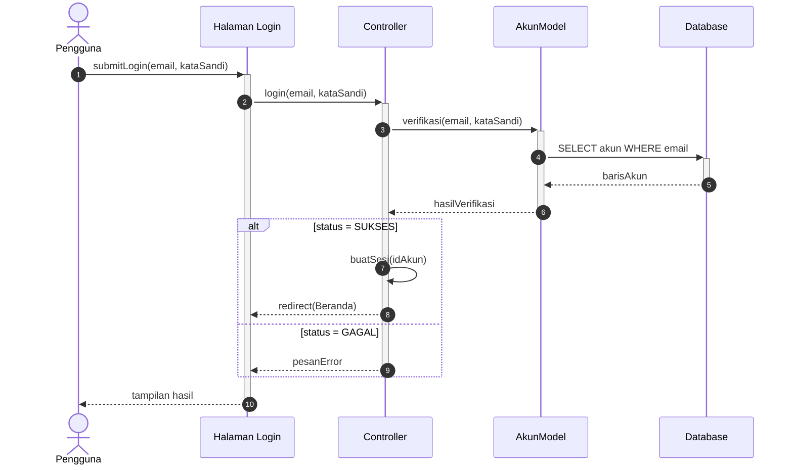
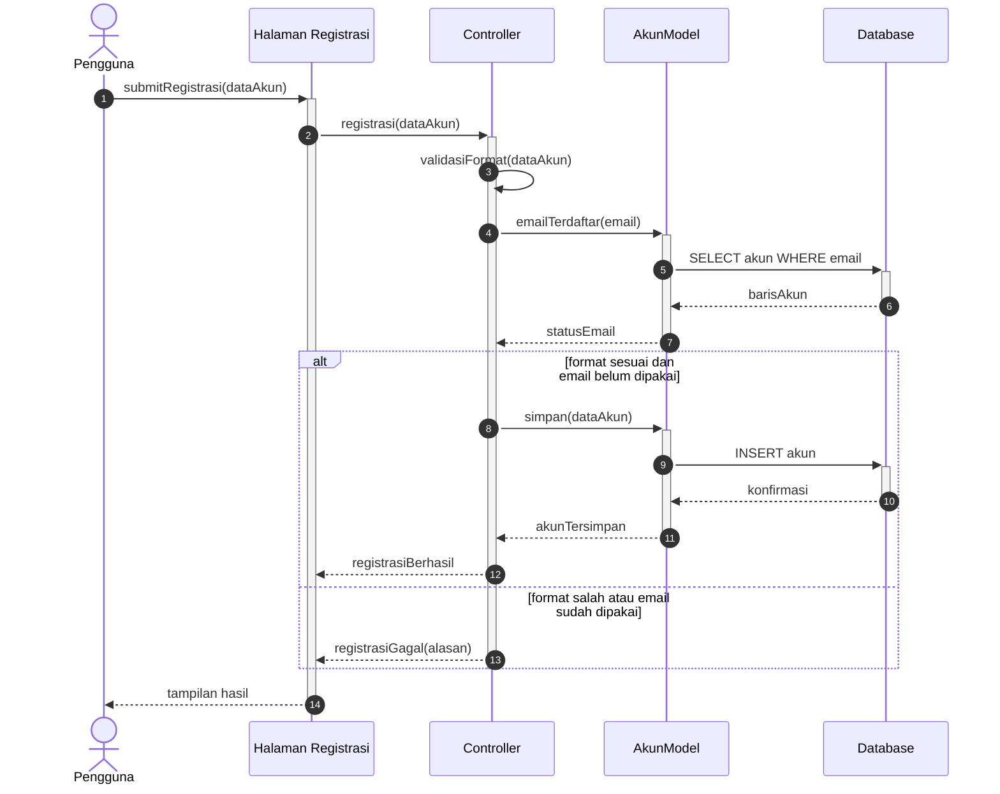
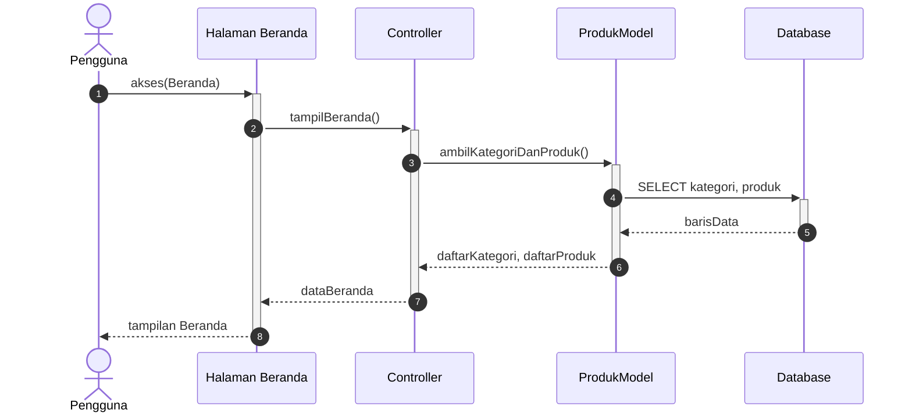
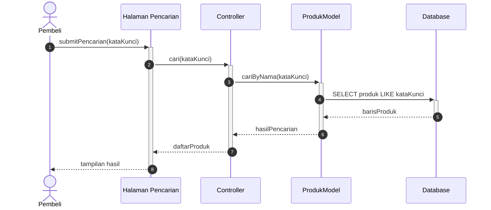
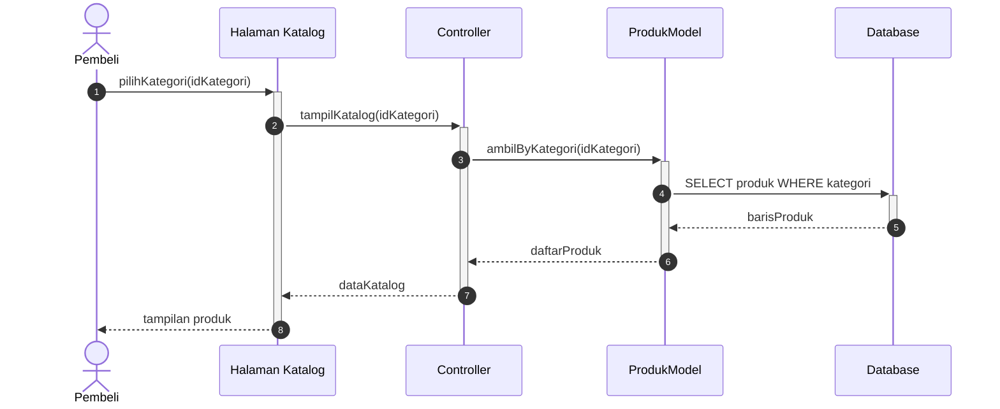
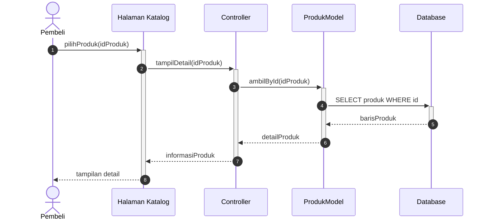
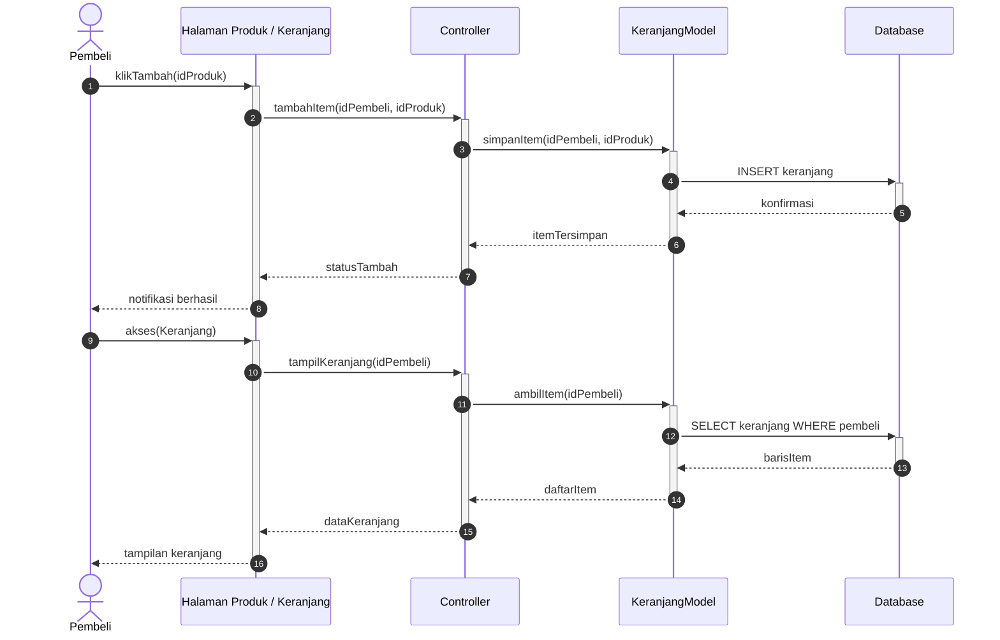
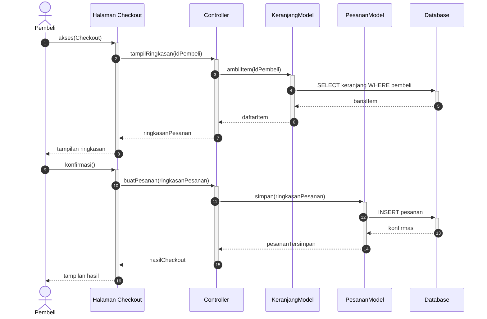
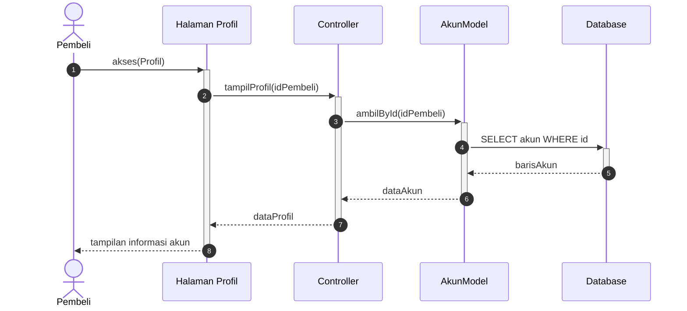
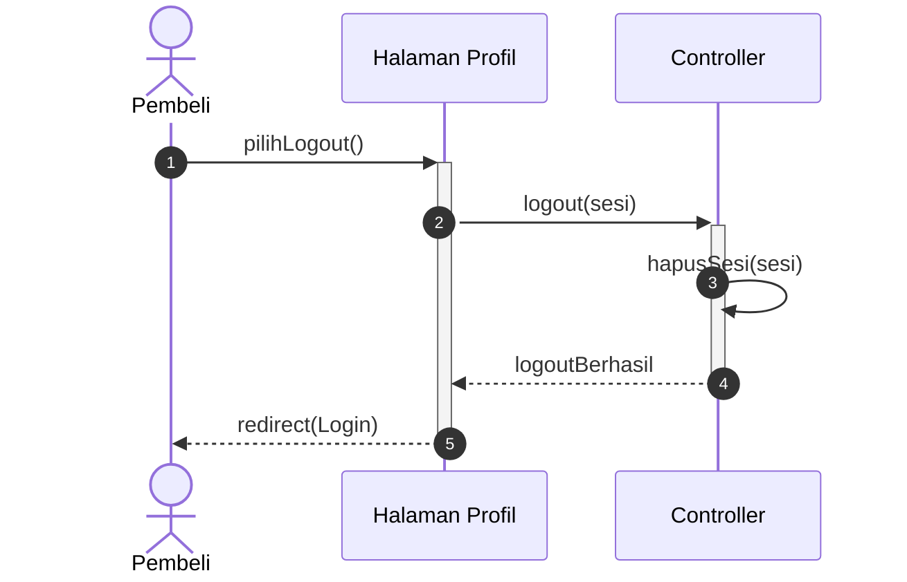

# PENJELASAN SEQUENCE DIAGRAM
## ClosetGirls ThriftShop

## 1. Pendahuluan

Sequence Diagram menggambarkan **pertukaran pesan antarobjek berdasarkan urutan waktu**. Yang ditampilkan adalah objek mana memanggil objek mana, operasi apa yang dipanggil, dan data apa yang dikembalikan.

Pada proyek ClosetGirls ThriftShop, objek yang terlibat dibagi mengikuti pola **View - Controller - Model - Database**:

| Objek | Peran |
|---|---|
| Aktor (Pengguna / Pembeli) | Pihak yang memicu fitur |
| Halaman (View) | Menerima input dan menampilkan hasil |
| Controller | Mengatur permintaan, validasi, dan sesi |
| Model (AkunModel, ProdukModel, KeranjangModel, PesananModel) | Mengelola data per entitas |
| Database | Menyimpan dan mengembalikan data |

## 2. Tujuan Sequence Diagram

1. Menunjukkan pesan dan nilai kembalian antarobjek pada setiap fitur.
2. Menunjukkan pembagian tanggung jawab View, Controller, Model, dan Database.
3. Menjadi acuan penamaan fungsi dan pengujian antarlapisan sistem.

## 3. Perbedaan dengan Activity Diagram

| Aspek | Activity Diagram | Sequence Diagram (dokumen ini) |
|---|---|---|
| Yang digambarkan | Urutan kegiatan dan keputusan | Pesan antarobjek menurut waktu |
| Pelaku | Pengguna dan sistem secara umum | View, Controller, Model, Database |
| Isi panah | Kalimat kegiatan | Nama operasi dan parameter, misalnya `login(email, kataSandi)` |
| Hasil proses | Langkah berikutnya | Nilai kembalian, misalnya `hasilVerifikasi` |
| Percabangan | Node keputusan | Hanya dua kemungkinan balasan Controller |

Penjelasan tiap fitur juga berbentuk **tabel pesan**, tidak berupa daftar langkah.

### Pemetaan terhadap Activity Diagram ClosetGirls ThriftShop

Activity Diagram proyek ini menggambarkan alur kegiatan pembeli (Masuk Website, Punya akun?, Registrasi, Isi Email & Password, Valid?, Masuk Beranda, Mencari Produk, dan seterusnya). Fitur yang sama dalam Sequence Diagram digambarkan sebagai pesan antarobjek:

| Kegiatan pada Activity Diagram | Padanan pada Sequence Diagram |
|---|---|
| Punya akun? lalu Registrasi | `registrasi(dataAkun)`, `emailTerdaftar(email)`, `simpan(dataAkun)` |
| Isi Email & Password, Website Login, Valid? | `login(email, kataSandi)`, `verifikasi(email, kataSandi)`, `hasilVerifikasi` |
| Masuk Beranda | `tampilBeranda()`, `ambilKategoriDanProduk()` |
| Mencari Produk | `cari(kataKunci)`, `cariByNama(kataKunci)` |
| Lihat detail produk | `tampilDetail(idProduk)`, `ambilById(idProduk)` |
| Masukkan Ke Keranjang | `tambahItem(idPembeli, idProduk)`, `simpanItem(...)` |
| Checkout, Pesanan Berhasil | `tampilRingkasan(...)`, `buatPesanan(...)`, `simpan(...)` |
| Lihat profil | `tampilProfil(idPembeli)`, `ambilById(idPembeli)` |
| Logout akun, kembali ke halaman login | `logout(sesi)`, `hapusSesi(sesi)`, `redirect(Login)` |

Fitur Katalog hanya ada pada Sequence Diagram, sedangkan Proses Pembayaran hanya ada pada Activity Diagram dan belum dimodelkan sebagai pesan.

## 4. Keterangan Notasi

| Notasi | Arti |
|---|---|
| Panah penuh | Permintaan (pemanggilan operasi) |
| Panah putus-putus | Balasan (nilai kembalian) |
| Panah ke objek yang sama | Pemrosesan internal |
| Batang di lifeline | Objek sedang memproses pesan |
| `alt` | Dua kemungkinan balasan yang saling menggantikan |
| Nomor pada panah | Urutan pesan |

---

# 5. Sequence Diagram Login

## Pengertian

Menggambarkan pertukaran pesan antarobjek ketika kredensial dikirim, diverifikasi ke database, dan sesi dibuat.

## Diagram

## Penjelasan Interaksi

| No | Dari | Ke | Pesan | Jenis |
|---|---|---|---|---|
| 1 | Pengguna | Halaman Login | `submitLogin(email, kataSandi)` | Permintaan |
| 2 | Halaman Login | Controller | `login(email, kataSandi)` | Permintaan |
| 3 | Controller | AkunModel | `verifikasi(email, kataSandi)` | Permintaan |
| 4 | AkunModel | Database | `SELECT akun WHERE email` | Permintaan |
| 5 | Database | AkunModel | `barisAkun` | Balasan |
| 6 | AkunModel | Controller | `hasilVerifikasi` | Balasan |
| 7 | Controller | Controller | `buatSesi(idAkun)` | Internal |
| 8 | Controller | Halaman Login | `redirect(Beranda)` | Balasan |
| 9 | Controller | Halaman Login | `pesanError` | Balasan |
| 10 | Halaman Login | Pengguna | `tampilan hasil` | Balasan |

**Catatan:** Pembuatan sesi hanya terjadi di Controller setelah Model mengembalikan hasil valid.

---

# 6. Sequence Diagram Registrasi

## Pengertian

Menggambarkan pertukaran pesan ketika data akun baru divalidasi, dicek keunikannya, dan disimpan.

## Diagram

## Penjelasan Interaksi

| No | Dari | Ke | Pesan | Jenis |
|---|---|---|---|---|
| 1 | Pengguna | Halaman Registrasi | `submitRegistrasi(dataAkun)` | Permintaan |
| 2 | Halaman Registrasi | Controller | `registrasi(dataAkun)` | Permintaan |
| 3 | Controller | Controller | `validasiFormat(dataAkun)` | Internal |
| 4 | Controller | AkunModel | `emailTerdaftar(email)` | Permintaan |
| 5 | AkunModel | Database | `SELECT akun WHERE email` | Permintaan |
| 6 | Database | AkunModel | `barisAkun` | Balasan |
| 7 | AkunModel | Controller | `statusEmail` | Balasan |
| 8 | Controller | AkunModel | `simpan(dataAkun)` | Permintaan |
| 9 | AkunModel | Database | `INSERT akun` | Permintaan |
| 10 | Database | AkunModel | `konfirmasi` | Balasan |
| 11 | AkunModel | Controller | `akunTersimpan` | Balasan |
| 12 | Controller | Halaman Registrasi | `registrasiBerhasil` | Balasan |
| 13 | Controller | Halaman Registrasi | `registrasiGagal(alasan)` | Balasan |
| 14 | Halaman Registrasi | Pengguna | `tampilan hasil` | Balasan |

**Catatan:** Validasi format dilakukan Controller, sedangkan pengecekan dan penyimpanan akun dilakukan Model.

---

# 7. Sequence Diagram Beranda

## Pengertian

Menggambarkan pertukaran pesan untuk memuat kategori dan produk pada halaman utama.

## Diagram

## Penjelasan Interaksi

| No | Dari | Ke | Pesan | Jenis |
|---|---|---|---|---|
| 1 | Pengguna | Halaman Beranda | `akses(Beranda)` | Permintaan |
| 2 | Halaman Beranda | Controller | `tampilBeranda()` | Permintaan |
| 3 | Controller | ProdukModel | `ambilKategoriDanProduk()` | Permintaan |
| 4 | ProdukModel | Database | `SELECT kategori, produk` | Permintaan |
| 5 | Database | ProdukModel | `barisData` | Balasan |
| 6 | ProdukModel | Controller | `daftarKategori, daftarProduk` | Balasan |
| 7 | Controller | Halaman Beranda | `dataBeranda` | Balasan |
| 8 | Halaman Beranda | Pengguna | `tampilan Beranda` | Balasan |

**Catatan:** Data kategori dan produk diambil lewat satu pemanggilan ke Model.

---

# 8. Sequence Diagram Pencarian Produk

## Pengertian

Menggambarkan pertukaran pesan ketika kata kunci dikirim dan hasil pencarian dikembalikan.

## Diagram

## Penjelasan Interaksi

| No | Dari | Ke | Pesan | Jenis |
|---|---|---|---|---|
| 1 | Pembeli | Halaman Pencarian | `submitPencarian(kataKunci)` | Permintaan |
| 2 | Halaman Pencarian | Controller | `cari(kataKunci)` | Permintaan |
| 3 | Controller | ProdukModel | `cariByNama(kataKunci)` | Permintaan |
| 4 | ProdukModel | Database | `SELECT produk LIKE kataKunci` | Permintaan |
| 5 | Database | ProdukModel | `barisProduk` | Balasan |
| 6 | ProdukModel | Controller | `hasilPencarian` | Balasan |
| 7 | Controller | Halaman Pencarian | `daftarProduk` | Balasan |
| 8 | Halaman Pencarian | Pembeli | `tampilan hasil` | Balasan |

**Catatan:** Pencocokan kata kunci dilakukan di tingkat query database.

---

# 9. Sequence Diagram Katalog

## Pengertian

Menggambarkan pertukaran pesan ketika produk per kategori dimuat ke halaman Katalog.

## Diagram

## Penjelasan Interaksi

| No | Dari | Ke | Pesan | Jenis |
|---|---|---|---|---|
| 1 | Pembeli | Halaman Katalog | `pilihKategori(idKategori)` | Permintaan |
| 2 | Halaman Katalog | Controller | `tampilKatalog(idKategori)` | Permintaan |
| 3 | Controller | ProdukModel | `ambilByKategori(idKategori)` | Permintaan |
| 4 | ProdukModel | Database | `SELECT produk WHERE kategori` | Permintaan |
| 5 | Database | ProdukModel | `barisProduk` | Balasan |
| 6 | ProdukModel | Controller | `daftarProduk` | Balasan |
| 7 | Controller | Halaman Katalog | `dataKatalog` | Balasan |
| 8 | Halaman Katalog | Pembeli | `tampilan produk` | Balasan |

**Catatan:** Filter kategori diteruskan sampai ke query database.

---

# 10. Sequence Diagram Detail Produk

## Pengertian

Menggambarkan pertukaran pesan ketika informasi lengkap satu produk diminta.

## Diagram

## Penjelasan Interaksi

| No | Dari | Ke | Pesan | Jenis |
|---|---|---|---|---|
| 1 | Pembeli | Halaman Katalog | `pilihProduk(idProduk)` | Permintaan |
| 2 | Halaman Katalog | Controller | `tampilDetail(idProduk)` | Permintaan |
| 3 | Controller | ProdukModel | `ambilById(idProduk)` | Permintaan |
| 4 | ProdukModel | Database | `SELECT produk WHERE id` | Permintaan |
| 5 | Database | ProdukModel | `barisProduk` | Balasan |
| 6 | ProdukModel | Controller | `detailProduk` | Balasan |
| 7 | Controller | Halaman Katalog | `informasiProduk` | Balasan |
| 8 | Halaman Katalog | Pembeli | `tampilan detail` | Balasan |

**Catatan:** `detailProduk` dapat mencakup foto, nama, harga, kategori, ukuran, kondisi, deskripsi, dan stok.

---

# 11. Sequence Diagram Keranjang

## Pengertian

Menggambarkan dua interaksi: menyimpan item ke keranjang, lalu mengambil isi keranjang.

## Diagram

## Penjelasan Interaksi

| No | Dari | Ke | Pesan | Jenis |
|---|---|---|---|---|
| 1 | Pembeli | Halaman Produk / Keranjang | `klikTambah(idProduk)` | Permintaan |
| 2 | Halaman Produk / Keranjang | Controller | `tambahItem(idPembeli, idProduk)` | Permintaan |
| 3 | Controller | KeranjangModel | `simpanItem(idPembeli, idProduk)` | Permintaan |
| 4 | KeranjangModel | Database | `INSERT keranjang` | Permintaan |
| 5 | Database | KeranjangModel | `konfirmasi` | Balasan |
| 6 | KeranjangModel | Controller | `itemTersimpan` | Balasan |
| 7 | Controller | Halaman Produk / Keranjang | `statusTambah` | Balasan |
| 8 | Halaman Produk / Keranjang | Pembeli | `notifikasi berhasil` | Balasan |
| 9 | Pembeli | Halaman Produk / Keranjang | `akses(Keranjang)` | Permintaan |
| 10 | Halaman Produk / Keranjang | Controller | `tampilKeranjang(idPembeli)` | Permintaan |
| 11 | Controller | KeranjangModel | `ambilItem(idPembeli)` | Permintaan |
| 12 | KeranjangModel | Database | `SELECT keranjang WHERE pembeli` | Permintaan |
| 13 | Database | KeranjangModel | `barisItem` | Balasan |
| 14 | KeranjangModel | Controller | `daftarItem` | Balasan |
| 15 | Controller | Halaman Produk / Keranjang | `dataKeranjang` | Balasan |
| 16 | Halaman Produk / Keranjang | Pembeli | `tampilan keranjang` | Balasan |

**Catatan:** Dua interaksi memakai lifeline yang sama, sehingga terlihat bahwa penyimpanan dan pembacaan keranjang ditangani objek yang sama.

---

# 12. Sequence Diagram Checkout

## Pengertian

Menggambarkan dua interaksi: memuat ringkasan pesanan, lalu menyimpan pesanan yang dikonfirmasi.

## Diagram

## Penjelasan Interaksi

| No | Dari | Ke | Pesan | Jenis |
|---|---|---|---|---|
| 1 | Pembeli | Halaman Checkout | `akses(Checkout)` | Permintaan |
| 2 | Halaman Checkout | Controller | `tampilRingkasan(idPembeli)` | Permintaan |
| 3 | Controller | KeranjangModel | `ambilItem(idPembeli)` | Permintaan |
| 4 | KeranjangModel | Database | `SELECT keranjang WHERE pembeli` | Permintaan |
| 5 | Database | KeranjangModel | `barisItem` | Balasan |
| 6 | KeranjangModel | Controller | `daftarItem` | Balasan |
| 7 | Controller | Halaman Checkout | `ringkasanPesanan` | Balasan |
| 8 | Halaman Checkout | Pembeli | `tampilan ringkasan` | Balasan |
| 9 | Pembeli | Halaman Checkout | `konfirmasi()` | Permintaan |
| 10 | Halaman Checkout | Controller | `buatPesanan(ringkasanPesanan)` | Permintaan |
| 11 | Controller | PesananModel | `simpan(ringkasanPesanan)` | Permintaan |
| 12 | PesananModel | Database | `INSERT pesanan` | Permintaan |
| 13 | Database | PesananModel | `konfirmasi` | Balasan |
| 14 | PesananModel | Controller | `pesananTersimpan` | Balasan |
| 15 | Controller | Halaman Checkout | `hasilCheckout` | Balasan |
| 16 | Halaman Checkout | Pembeli | `tampilan hasil` | Balasan |

**Catatan:** Pembacaan keranjang ditangani KeranjangModel, sedangkan penyimpanan pesanan ditangani PesananModel.

---

# 13. Sequence Diagram Profil

## Pengertian

Menggambarkan pertukaran pesan untuk mengambil dan menampilkan data akun pembeli.

## Diagram

## Penjelasan Interaksi

| No | Dari | Ke | Pesan | Jenis |
|---|---|---|---|---|
| 1 | Pembeli | Halaman Profil | `akses(Profil)` | Permintaan |
| 2 | Halaman Profil | Controller | `tampilProfil(idPembeli)` | Permintaan |
| 3 | Controller | AkunModel | `ambilById(idPembeli)` | Permintaan |
| 4 | AkunModel | Database | `SELECT akun WHERE id` | Permintaan |
| 5 | Database | AkunModel | `barisAkun` | Balasan |
| 6 | AkunModel | Controller | `dataAkun` | Balasan |
| 7 | Controller | Halaman Profil | `dataProfil` | Balasan |
| 8 | Halaman Profil | Pembeli | `tampilan informasi akun` | Balasan |

**Catatan:** Data akun diambil berdasarkan identitas pembeli yang sedang login.

---

# 14. Sequence Diagram Keluar Akun

## Pengertian

Menggambarkan pertukaran pesan ketika sesi pembeli diakhiri. Database tidak terlibat karena sesi diakhiri oleh Controller.

## Diagram

## Penjelasan Interaksi

| No | Dari | Ke | Pesan | Jenis |
|---|---|---|---|---|
| 1 | Pembeli | Halaman Profil | `pilihLogout()` | Permintaan |
| 2 | Halaman Profil | Controller | `logout(sesi)` | Permintaan |
| 3 | Controller | Controller | `hapusSesi(sesi)` | Internal |
| 4 | Controller | Halaman Profil | `logoutBerhasil` | Balasan |
| 5 | Halaman Profil | Pembeli | `redirect(Login)` | Balasan |

**Catatan:** Tidak ada pesan ke Model atau Database pada proses ini.

---

# 15. Kesimpulan

Sequence Diagram ClosetGirls ThriftShop menggambarkan pertukaran pesan antara aktor, View, Controller, Model, dan Database. Berbeda dengan Activity Diagram yang menekankan alur kegiatan, diagram ini menekankan operasi yang dipanggil antarobjek dan data yang dikembalikan.

Fitur yang tercakup: Login, Registrasi, Beranda, Pencarian Produk, Katalog, Detail Produk, Keranjang, Checkout, Profil, dan Keluar Akun.
